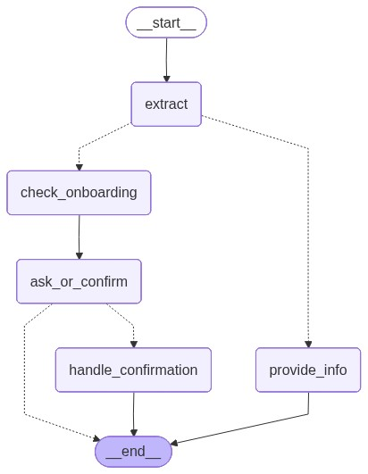
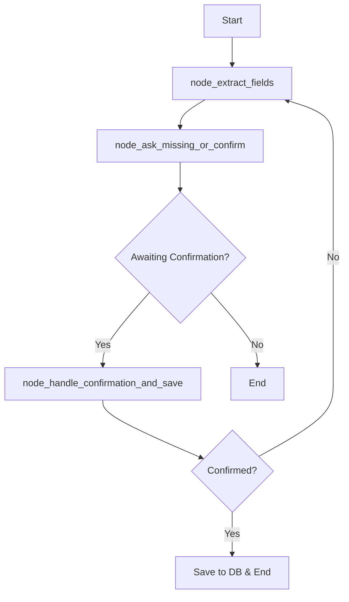

# medAgenda - Appointment Scheduling Agent POC

🏥 **medAgenda** é um agente conversacional de atendimento para agendamento de consultas médicas, implementado com **LangGraph** e **FastAPI**.

## 🎯 Objetivo

Criar um assistente estilo "secretária virtual" que:
- ✅ Coleta dados do paciente através de conversa natural
- ✅ Extrai campos automaticamente do texto (sem LLM)
- ✅ Confirma os dados antes de salvar
- ✅ Registra pedidos de agendamento no SQLite
- ❌ **NÃO** faz diagnóstico, tratamento ou orientação médica

## 🔒 Restrições de Segurança

O agente possui **barreiras rígidas** de segurança:

- **Diagnóstico/Tratamento**: Se o usuário pedir diagnóstico ou orientação clínica, o agente responde:
  > "Eu só ajudo a marcar consulta. Você quer agendar com qual especialidade?"

- **Urgências**: Se detectar sintomas urgentes (dor no peito, falta de ar, etc.), responde:
  > "Posso ajudar a agendar, mas se você considerar urgente procure atendimento imediato."

- **Escopo**: O agente **apenas** coleta dados administrativos para agendamento.

## 🛠️ Stack Tecnológica

- **Python 3.11+**
- **FastAPI** - API REST
- **LangGraph** - Orquestração do fluxo conversacional
- **PydanticAI** - Extração estruturada com LLM
- **Pydantic** - Validação de dados
- **SQLite** - Persistência (sem ORM)
- **Uvicorn** - Servidor ASGI
- **Pytest** - Testes automatizados

### Providers LLM Suportados
- **Gemini** (Google) - Recomendado
- **OpenAI** (GPT-4o-mini)
- **Anthropic** (Claude Haiku)
- **Fallback** (Regex puro)

## 📁 Estrutura do Projeto

```
Bot/
├── app/
│   ├── agent/
│   │   ├── extractor/        # PydanticAI extraction (NEW)
│   │   │   ├── schema.py     # ExtractResult (source of truth)
│   │   │   ├── prompts.py    # System instructions
│   │   │   ├── factory.py    # Multi-provider agent creation
│   │   │   ├── adapter.py    # Main extraction interface
│   │   │   └── merge.py      # LLM + regex merge logic
│   │   ├── graph.py          # LangGraph state machine
│   │   ├── extract.py        # Extração regex (fallback)
│   │   ├── prompts.py        # Mensagens padrão
│   │   └── tools.py          # Utilitários
│   ├── db/
│   │   └── sqlite.py         # Operações de banco
│   ├── models/
│   │   └── schemas.py        # Schemas Pydantic
│   ├── config.py             # Configurações + LLM providers
│   └── main.py               # FastAPI app
├── docs/                     # Documentação completa
│   ├── PYDANTIC_AI.md        # Integração PydanticAI (NEW)
│   └── ...
├── tests/
│   ├── test_extractor_*.py   # Testes PydanticAI (NEW)
│   └── ...
├── .env.example              # Exemplo de variáveis (NEW)
├── streamlit_app.py          # Interface web Streamlit
├── requirements.txt
└── README.md
```

## 🚀 Como Rodar

### 1. Criar ambiente virtual

```bash
cd c:\Users\Usuario\Documents\programacao\MedAgenda\Bot
python -m venv venv
.\venv\Scripts\activate
```

### 2. Instalar dependências

```bash
pip install -r requirements.txt
pip install streamlit  # Para a interface web
```

### 3. Configurar LLM Provider (Opcional)

Crie um arquivo `.env` na raiz do projeto:

```bash
# Copiar exemplo
cp .env.example .env

# Editar e adicionar sua API key
# LLM_PROVIDER=gemini
# GOOGLE_API_KEY=your_key_here
```

**Providers disponíveis:**
- `gemini` - Google Gemini (recomendado)
- `openai` - OpenAI GPT-4o-mini
- `anthropic` - Anthropic Claude Haiku
- `fallback` - Regex puro (sem LLM, grátis)

**Sem configuração:** O sistema usa fallback (regex) automaticamente.

### 4. Rodar a API (Backend)

Em um terminal, execute:

```bash
uvicorn app.main:app --reload --port 8000
```

O servidor estará disponível em: `http://localhost:8000`

Acesse a documentação interativa em: `http://localhost:8000/docs`

### 4. Rodar a Interface Streamlit (Frontend)

**Em outro terminal**, ative o ambiente virtual e execute:

```bash

.\venv\Scripts\activate
streamlit run streamlit_app.py
```

A interface web abrirá automaticamente em: `http://localhost:8501`

### 5. Visualizar Diagrama do LangGraph (Opcional)

Para gerar o diagrama visual do fluxo do agente:

```bash
python generate_graph_diagram.py
```

Isso criará:
- `langgraph_diagram.mmd` - Código Mermaid
- `langgraph_diagram.png` - Imagem do diagrama



**Documentação:** [docs/LANGGRAPH_DIAGRAM.md](docs/LANGGRAPH_DIAGRAM.md)

### 🎯 Opções de Uso

Você pode usar o medAgenda de 3 formas:

1. **Interface Streamlit** (Recomendado para testes) 🌐
   - Interface visual amigável
   - Chat interativo
   - Visualização de agendamentos
   - Acesse: `http://localhost:8501`

2. **API REST** (Para integração) 🔌
   - Endpoints RESTful
   - Documentação Swagger
   - Acesse: `http://localhost:8000/docs`

3. **Linha de Comando** (Para testes rápidos) 💻
   - Usando curl ou PowerShell
   - Ver exemplos abaixo

## 📡 Endpoints da API

### 1. POST `/chat`

Processa mensagem do usuário através do agente.

**Request:**
```json
{
  "session_id": "user123",
  "message": "Quero marcar consulta com dermatologista",
  "channel": "web"
}
```

**Response:**
```json
{
  "session_id": "user123",
  "reply": "Ótimo! Para finalizar o agendamento, preciso de algumas informações:\n\n1. Qual é o seu nome completo?\n2. Qual é o seu WhatsApp/telefone?\n..."
}
```

**Exemplo com curl:**
```bash
curl -X POST http://localhost:8000/chat \
  -H "Content-Type: application/json" \
  -d "{\"session_id\": \"test1\", \"message\": \"Oi\", \"channel\": \"web\"}"
```

### 2. GET `/appointments`

Lista agendamentos com paginação.

**Query Parameters:**
- `limit` (default: 10, max: 100)
- `offset` (default: 0)

**Response:**
```json
{
  "total": 5,
  "appointments": [
    {
      "id": 1,
      "created_at": "2026-01-28T14:30:00",
      "name": "João Silva",
      "phone": "11987654321",
      "specialty": "dermatologista",
      "preferred_datetime": "amanhã às 14h",
      "mode": "presencial",
      "reason": null,
      "status": "confirmed",
      "channel": "web"
    }
  ]
}
```

**Exemplo com curl:**
```bash
curl http://localhost:8000/appointments?limit=5
```

### 3. GET `/appointments/{id}`

Busca agendamento específico por ID.

**Response:**
```json
{
  "id": 1,
  "created_at": "2026-01-28T14:30:00",
  "name": "João Silva",
  ...
}
```

**Exemplo com curl:**
```bash
curl http://localhost:8000/appointments/1
```

### 4. POST `/sessions/{session_id}/reset`

Reseta/limpa uma sessão.

**Response:**
```json
{
  "session_id": "test1",
  "message": "Session reset successfully"
}
```

**Exemplo com curl:**
```bash
curl -X POST http://localhost:8000/sessions/test1/reset
```

## 🤖 Fluxo do Agente (LangGraph)

O agente possui 3 nós principais:



### Nós:

1. **node_extract_fields**
   - Extrai campos do texto (telefone, nome, especialidade, etc.)
   - Detecta intents fora de escopo (diagnóstico/tratamento)
   - Calcula campos faltantes

2. **node_ask_missing_or_confirm**
   - Se intent fora de escopo: retorna mensagem padrão
   - Se faltam campos: pergunta os campos necessários
   - Se todos os campos coletados: gera mensagem de confirmação

3. **node_handle_confirmation_and_save**
   - Se usuário confirma (sim): salva no SQLite
   - Se usuário nega (não): permite ajustes
   - Retorna mensagem final

## 🧪 Testes

### Rodar todos os testes

```bash
pytest tests/ -v
```

### Rodar testes específicos

```bash
# Apenas testes de extração
pytest tests/test_extract.py -v

# Apenas testes de fluxo
pytest tests/test_agent_flow.py -v
```

### Cobertura de testes

```bash
pytest tests/ --cov=app --cov-report=html
```

## 💬 Exemplo de Conversa Completa

```bash
# 1. Iniciar conversa
curl -X POST http://localhost:8000/chat \
  -H "Content-Type: application/json" \
  -d '{"session_id": "demo", "message": "Oi"}'

# Resposta: "Oi! Eu sou o medAgenda 😊 Posso te ajudar a marcar uma consulta..."

# 2. Fornecer todas as informações de uma vez
curl -X POST http://localhost:8000/chat \
  -H "Content-Type: application/json" \
  -d '{"session_id": "demo", "message": "Me chamo João Silva, telefone 11 98765-4321, quero dermatologista presencial amanhã às 14h"}'

# Resposta: Confirmação com resumo dos dados

# 3. Confirmar
curl -X POST http://localhost:8000/chat \
  -H "Content-Type: application/json" \
  -d '{"session_id": "demo", "message": "sim"}'

# Resposta: "✅ Consulta agendada com sucesso! Número do agendamento: #1"

# 4. Verificar agendamento
curl http://localhost:8000/appointments/1
```

## 🔍 Extração de Campos (Sem LLM)

A extração usa **regex e heurísticas** para rapidez:

| Campo | Método |
|-------|--------|
| **Telefone** | Regex para formato BR (+55, DDD, hífen, espaços) |
| **Modo** | Keywords: "presencial", "online", "telemedicina" |
| **Especialidade** | Mapeamento de variações (dermato → dermatologista) |
| **Nome** | Padrões: "me chamo", "sou o/a", "nome:" |
| **Data/Hora** | Captura de texto livre (amanhã, 15/02, segunda) |
| **Motivo** | Padrões: "consulta para", "motivo:" |

## 🗄️ Banco de Dados

### Tabela `appointments`

| Coluna | Tipo | Descrição |
|--------|------|-----------|
| `id` | INTEGER PK | ID auto-incremento |
| `created_at` | TEXT | ISO timestamp |
| `name` | TEXT | Nome completo |
| `phone` | TEXT | Telefone/WhatsApp |
| `specialty` | TEXT | Especialidade médica |
| `preferred_datetime` | TEXT | Data/hora preferida (texto livre) |
| `mode` | TEXT | presencial\|online\|nao_informado |
| `reason` | TEXT | Motivo (opcional) |
| `status` | TEXT | new\|confirmed\|needs_followup |
| `channel` | TEXT | web\|whatsapp\|instagram\|unknown |

**Índices:**
- `idx_appointments_phone` em `phone`
- `idx_appointments_created_at` em `created_at`

## ⚙️ Configuração

Variáveis de ambiente (opcionais):

```bash
# Caminho do banco de dados
export DB_PATH=/caminho/para/medagenda.db

# Timeout de sessão (minutos)
export SESSION_TIMEOUT_MINUTES=30

# Modo debug
export DEBUG=true
```

## 🎨 Especialidades Suportadas

O agente normaliza automaticamente variações:

- **Dermatologia**: dermato, dermatologista, dermatologia
- **Cardiologia**: cardio, cardiologista, cardiologia
- **Ortopedia**: ortopedista, ortopedia, ortoped
- **Pediatria**: pediatra, pediatria
- **Ginecologia**: gineco, ginecologista, ginecologia
- **Oftalmologia**: oftalmo, oftalmologista, oftalmologia
- **Neurologia**: neuro, neurologista, neurologia
- **Psiquiatria**: psiquiatra, psiquiatria
- **Clínico Geral**: clinico geral, clínico geral, clinico

## 📝 Notas Importantes

1. **Sessões em Memória**: Para este POC, as sessões são armazenadas em memória (dict global). Em produção, use Redis ou similar.

2. **Sem Validação de Horários**: O agente aceita qualquer texto para data/hora. Não há validação de slots disponíveis (conforme especificado no POC).

3. **Extração Simples**: A extração de campos é baseada em regex/heurísticas. Para maior precisão, considere usar LLM em produção.

4. **CORS Aberto**: O CORS está configurado para aceitar todas as origens (`*`). Restrinja em produção.

## 🚨 Troubleshooting

### Erro: "ModuleNotFoundError: No module named 'langgraph'"

```bash
pip install --upgrade langgraph langchain-core
```

### Banco de dados não inicializa

Verifique permissões de escrita no diretório do projeto:

```bash
# Windows
icacls medagenda.db /grant Everyone:F
```

### Sessão não persiste entre requisições

Isso é esperado se o servidor for reiniciado. As sessões são em memória para o POC.

## 📄 Licença

Este é um projeto POC (Proof of Concept) para fins educacionais e demonstração.

---

**Desenvolvido com ❤️ usando LangGraph e FastAPI**
