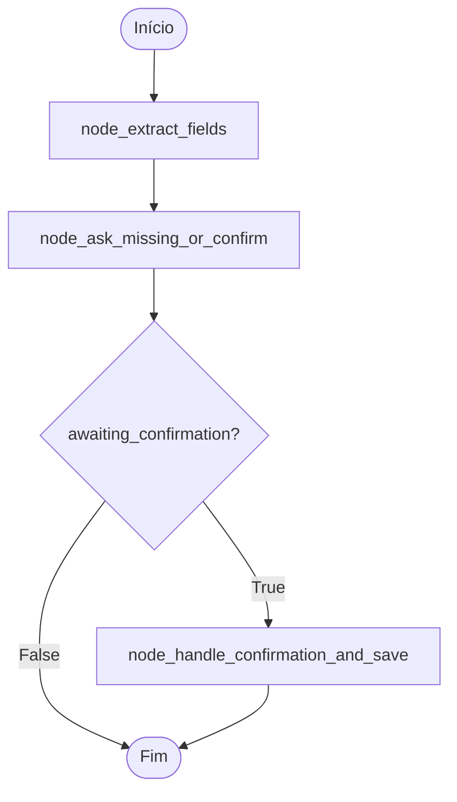

# 🔄 Fluxo do Agente - MedAgenda Bot

Este documento detalha o funcionamento interno do agente conversacional baseado em LangGraph.

## 🎯 Visão Geral

O agente MedAgenda usa uma **máquina de estados** implementada com LangGraph para orquestrar o fluxo conversacional. O grafo possui **3 nós principais** que processam a mensagem do usuário e decidem a próxima ação.

## 📊 Diagrama do Grafo



## 🔧 Estrutura do Estado

```python
class AgentState(TypedDict):
    """Estado compartilhado entre todos os nós do grafo"""
    
    # Histórico de mensagens
    messages: list[str]
    
    # Mensagem atual do usuário
    current_message: str
    
    # Campos já extraídos {campo: valor}
    extracted_fields: dict
    
    # Lista de campos ainda faltantes
    missing_fields: list[str]
    
    # Flag: aguardando confirmação do usuário?
    awaiting_confirmation: bool
    
    # Resposta que será enviada ao usuário
    reply: str
    
    # Flag: mensagem está fora do escopo?
    out_of_scope: bool
```

## 📍 Nó 1: `node_extract_fields`

### Responsabilidades

1. Extrair campos da mensagem atual usando `extract.py`
2. Mesclar com campos já extraídos anteriormente
3. Detectar intents fora de escopo
4. Calcular quais campos ainda estão faltando

### Implementação

```python
def node_extract_fields(state: AgentState) -> AgentState:
    """
    Extrai campos da mensagem atual e atualiza o estado.
    """
    current_msg = state["current_message"]
    
    # 1. Extrair campos da mensagem
    new_fields = extract_fields(current_msg)
    
    # 2. Mesclar com campos existentes (novos sobrescrevem)
    extracted = state.get("extracted_fields", {})
    extracted.update(new_fields)
    
    # 3. Detectar intent fora de escopo
    out_of_scope = detect_out_of_scope_intent(current_msg)
    
    # 4. Calcular campos faltantes
    missing = []
    if not out_of_scope:
        for field in REQUIRED_FIELDS:
            if field not in extracted or not extracted[field]:
                missing.append(field)
    
    # 5. Atualizar estado
    return {
        **state,
        "extracted_fields": extracted,
        "missing_fields": missing,
        "out_of_scope": out_of_scope,
    }
```

### Exemplo de Execução

**Input:**
```python
state = {
    "current_message": "Me chamo João Silva, telefone 11 98765-4321",
    "extracted_fields": {},
    "messages": ["Oi", "Quero marcar consulta"],
}
```

**Output:**
```python
{
    "current_message": "Me chamo João Silva, telefone 11 98765-4321",
    "extracted_fields": {
        "name": "João Silva",
        "phone": "11987654321"
    },
    "missing_fields": ["specialty", "preferred_datetime"],
    "out_of_scope": False,
    "messages": ["Oi", "Quero marcar consulta"],
}
```

## 📍 Nó 2: `node_ask_missing_or_confirm`

### Responsabilidades

1. Se `out_of_scope=True`: retornar mensagem de redirecionamento
2. Se há campos faltantes: perguntar os campos necessários
3. Se todos os campos coletados: gerar mensagem de confirmação

### Implementação

```python
def node_ask_missing_or_confirm(state: AgentState) -> AgentState:
    """
    Decide se pergunta campos faltantes ou confirma dados.
    """
    # Caso 1: Intent fora de escopo
    if state.get("out_of_scope"):
        return {
            **state,
            "reply": OUT_OF_SCOPE_MESSAGE,
            "awaiting_confirmation": False,
        }
    
    # Caso 2: Ainda faltam campos
    if state["missing_fields"]:
        reply = build_missing_fields_question(state["missing_fields"])
        return {
            **state,
            "reply": reply,
            "awaiting_confirmation": False,
        }
    
    # Caso 3: Todos os campos coletados → Confirmar
    reply = build_confirmation_message(state["extracted_fields"])
    return {
        **state,
        "reply": reply,
        "awaiting_confirmation": True,
    }
```

### Exemplo de Execução

**Cenário 1: Campos Faltantes**

```python
# Input
state = {
    "missing_fields": ["specialty", "preferred_datetime"],
    "out_of_scope": False,
}

# Output
{
    "reply": "Para finalizar, preciso saber:\n1. Qual especialidade?\n2. Quando prefere?",
    "awaiting_confirmation": False,
}
```

**Cenário 2: Todos os Campos Coletados**

```python
# Input
state = {
    "missing_fields": [],
    "extracted_fields": {
        "name": "João Silva",
        "phone": "11987654321",
        "specialty": "dermatologista",
        "preferred_datetime": "amanhã às 14h"
    },
    "out_of_scope": False,
}

# Output
{
    "reply": "Confirma os dados?\n\nNome: João Silva\nTelefone: 11987654321\n...",
    "awaiting_confirmation": True,
}
```

## 📍 Nó 3: `node_handle_confirmation_and_save`

### Responsabilidades

1. Detectar se usuário confirmou ou negou
2. Se confirmou: salvar no banco de dados
3. Se negou: permitir ajustes
4. Gerar mensagem final

### Implementação

```python
def node_handle_confirmation_and_save(state: AgentState) -> AgentState:
    """
    Processa confirmação e salva no banco se confirmado.
    """
    # Só executa se estiver aguardando confirmação
    if not state.get("awaiting_confirmation"):
        return state
    
    current_msg = state["current_message"].lower().strip()
    
    # Detectar confirmação
    confirmed = any(word in current_msg for word in ["sim", "confirmo", "ok", "yes"])
    denied = any(word in current_msg for word in ["não", "nao", "no"])
    
    # Caso 1: Usuário confirmou
    if confirmed:
        # Salvar no banco
        appointment_id = insert_appointment(state["extracted_fields"])
        
        reply = f"✅ Consulta agendada com sucesso!\n\nNúmero do agendamento: #{appointment_id}"
        
        return {
            **state,
            "reply": reply,
            "awaiting_confirmation": False,
        }
    
    # Caso 2: Usuário negou
    elif denied:
        reply = "Ok! O que você gostaria de ajustar?"
        
        return {
            **state,
            "reply": reply,
            "awaiting_confirmation": False,
            # Limpa campos para permitir reedição
            "extracted_fields": {},
            "missing_fields": REQUIRED_FIELDS.copy(),
        }
    
    # Caso 3: Resposta ambígua
    else:
        reply = "Não entendi. Você confirma os dados? (sim/não)"
        return {
            **state,
            "reply": reply,
        }
```

### Exemplo de Execução

**Cenário 1: Confirmação**

```python
# Input
state = {
    "current_message": "sim",
    "awaiting_confirmation": True,
    "extracted_fields": {...},
}

# Output
{
    "reply": "✅ Consulta agendada com sucesso!\n\nNúmero do agendamento: #1",
    "awaiting_confirmation": False,
}
```

**Cenário 2: Negação**

```python
# Input
state = {
    "current_message": "não",
    "awaiting_confirmation": True,
}

# Output
{
    "reply": "Ok! O que você gostaria de ajustar?",
    "awaiting_confirmation": False,
    "extracted_fields": {},
    "missing_fields": ["name", "phone", "specialty", "preferred_datetime"],
}
```

## 🔀 Condições de Transição

O grafo usa uma função de decisão para determinar se deve executar o nó 3:

```python
def should_handle_confirmation(state: AgentState) -> str:
    """
    Decide se deve ir para o nó de confirmação ou terminar.
    """
    if state.get("awaiting_confirmation"):
        return "handle_confirmation"
    else:
        return END
```

## 🔄 Fluxo Completo de Exemplo

### Exemplo 1: Agendamento Completo

```
┌─────────────────────────────────────────────────────────────┐
│ Turno 1                                                     │
├─────────────────────────────────────────────────────────────┤
│ User: "Oi"                                                  │
│                                                             │
│ [Nó 1] Extrai: {}                                          │
│ [Nó 2] Faltam todos os campos                              │
│                                                             │
│ Bot: "Oi! Posso te ajudar a marcar consulta..."            │
└─────────────────────────────────────────────────────────────┘

┌─────────────────────────────────────────────────────────────┐
│ Turno 2                                                     │
├─────────────────────────────────────────────────────────────┤
│ User: "Me chamo João Silva, telefone 11 98765-4321,        │
│        quero dermatologista presencial amanhã às 14h"       │
│                                                             │
│ [Nó 1] Extrai: {name, phone, specialty, preferred_datetime}│
│ [Nó 2] Todos os campos coletados → Gera confirmação        │
│                                                             │
│ Bot: "Confirma os dados?                                    │
│       Nome: João Silva                                      │
│       Telefone: 11987654321                                 │
│       Especialidade: dermatologista                         │
│       ..."                                                  │
└─────────────────────────────────────────────────────────────┘

┌─────────────────────────────────────────────────────────────┐
│ Turno 3                                                     │
├─────────────────────────────────────────────────────────────┤
│ User: "sim"                                                 │
│                                                             │
│ [Nó 1] Extrai: {}                                          │
│ [Nó 2] awaiting_confirmation=True → Pula                   │
│ [Nó 3] Detecta confirmação → Salva no banco                │
│                                                             │
│ Bot: "✅ Consulta agendada com sucesso! #1"                 │
└─────────────────────────────────────────────────────────────┘
```

### Exemplo 2: Coleta Gradual

```
┌─────────────────────────────────────────────────────────────┐
│ Turno 1                                                     │
├─────────────────────────────────────────────────────────────┤
│ User: "Quero marcar consulta"                               │
│                                                             │
│ [Nó 1] Extrai: {}                                          │
│ [Nó 2] Faltam: [name, phone, specialty, preferred_datetime]│
│                                                             │
│ Bot: "Para finalizar, preciso de:                           │
│       1. Qual é o seu nome completo?                        │
│       2. Qual é o seu telefone?                             │
│       ..."                                                  │
└─────────────────────────────────────────────────────────────┘

┌─────────────────────────────────────────────────────────────┐
│ Turno 2                                                     │
├─────────────────────────────────────────────────────────────┤
│ User: "João Silva"                                          │
│                                                             │
│ [Nó 1] Extrai: {name: "João Silva"}                        │
│ [Nó 2] Faltam: [phone, specialty, preferred_datetime]      │
│                                                             │
│ Bot: "Obrigado! Agora preciso de:                           │
│       1. Qual é o seu telefone?                             │
│       ..."                                                  │
└─────────────────────────────────────────────────────────────┘

[... continua até coletar todos os campos ...]
```

### Exemplo 3: Intent Fora de Escopo

```
┌─────────────────────────────────────────────────────────────┐
│ Turno 1                                                     │
├─────────────────────────────────────────────────────────────┤
│ User: "Estou com dor no peito, o que pode ser?"            │
│                                                             │
│ [Nó 1] Extrai: {} + out_of_scope=True                      │
│ [Nó 2] Detecta escopo → Retorna mensagem padrão            │
│                                                             │
│ Bot: "Eu só ajudo a marcar consulta.                        │
│       Você quer agendar com qual especialidade?"            │
└─────────────────────────────────────────────────────────────┘
```

## 🎯 Campos Obrigatórios

```python
REQUIRED_FIELDS = [
    "name",                 # Nome completo
    "phone",                # Telefone/WhatsApp
    "specialty",            # Especialidade médica
    "preferred_datetime",   # Data/hora preferida
]
```

## 🔍 Detecção de Escopo

```python
OUT_OF_SCOPE_KEYWORDS = [
    "diagnostico", "tratamento", "remedio", "medicamento",
    "o que pode ser", "estou com", "dor em", "sintoma",
    "doença", "cura", "como tratar"
]

def detect_out_of_scope_intent(text: str) -> bool:
    """Detecta se a mensagem está fora do escopo de agendamento"""
    text_lower = text.lower()
    return any(keyword in text_lower for keyword in OUT_OF_SCOPE_KEYWORDS)
```

## 📝 Templates de Mensagens

### Saudação
```python
GREETING_MESSAGE = """
Oi! Eu sou o medAgenda 😊

Posso te ajudar a marcar uma consulta médica.

Para começar, me diga qual especialidade você precisa?
"""
```

### Fora de Escopo
```python
OUT_OF_SCOPE_MESSAGE = """
Eu só ajudo a marcar consulta. 
Não posso dar diagnóstico ou orientação médica.

Você quer agendar com qual especialidade?
"""
```

### Confirmação
```python
CONFIRMATION_TEMPLATE = """
Confirma os dados abaixo? (sim/não)

📋 **Dados do Agendamento:**
• Nome: {name}
• Telefone: {phone}
• Especialidade: {specialty}
• Data/Hora: {preferred_datetime}
• Modo: {mode}
{reason_line}
"""
```

## 🚀 Otimizações Implementadas

1. **Extração Incremental**: Campos extraídos são preservados entre turnos
2. **Mesclagem Inteligente**: Novos valores sobrescrevem antigos
3. **Detecção Precoce de Escopo**: Evita processamento desnecessário
4. **Confirmação Explícita**: Reduz erros de dados

## 📚 Documentos Relacionados

- **[EXTRACTION.md](./EXTRACTION.md)** - Detalhes da extração de campos
- **[DATABASE.md](./DATABASE.md)** - Salvamento no banco
- **[AI_CONTEXT.md](./AI_CONTEXT.md)** - Contexto completo para IA

---

[← Voltar ao Índice](./INDEX.md)
