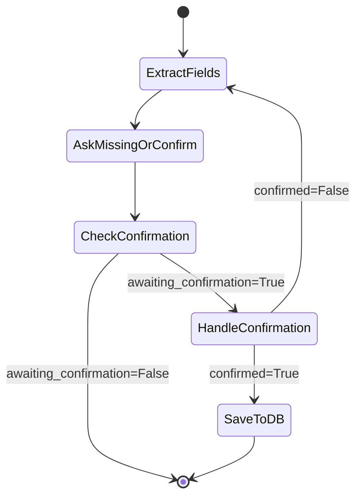

# 🏗️ Arquitetura - MedAgenda Bot

## Visão Geral da Arquitetura

O MedAgenda Bot segue uma arquitetura em camadas com separação clara de responsabilidades:

```
┌─────────────────────────────────────────────────────────┐
│                    Presentation Layer                    │
│  ┌──────────────┐  ┌──────────────┐  ┌──────────────┐  │
│  │  Streamlit   │  │   WhatsApp   │  │  Instagram   │  │
│  │     UI       │  │   (futuro)   │  │   (futuro)   │  │
│  └──────────────┘  └──────────────┘  └──────────────┘  │
└────────────────────────┬────────────────────────────────┘
                         │ HTTP/REST
┌────────────────────────▼────────────────────────────────┐
│                    API Layer (FastAPI)                   │
│  ┌────────────────────────────────────────────────────┐ │
│  │  Endpoints:                                        │ │
│  │  - POST /chat                                      │ │
│  │  - GET  /appointments                              │ │
│  │  - GET  /appointments/{id}                         │ │
│  │  - POST /sessions/{id}/reset                       │ │
│  └────────────────────────────────────────────────────┘ │
└────────────────────────┬────────────────────────────────┘
                         │
┌────────────────────────▼────────────────────────────────┐
│                  Business Logic Layer                    │
│  ┌────────────────────────────────────────────────────┐ │
│  │           LangGraph Agent (graph.py)               │ │
│  │  ┌──────────────────────────────────────────────┐  │ │
│  │  │  State Machine:                              │  │ │
│  │  │  1. node_extract_fields                      │  │ │
│  │  │  2. node_ask_missing_or_confirm              │  │ │
│  │  │  3. node_handle_confirmation_and_save        │  │ │
│  │  └──────────────────────────────────────────────┘  │ │
│  └────────────────────────────────────────────────────┘ │
│                                                          │
│  ┌────────────────────────────────────────────────────┐ │
│  │         Extraction Module (extract.py)             │ │
│  │  - Regex patterns                                  │ │
│  │  - Heuristics                                      │ │
│  │  - Field normalization                             │ │
│  └────────────────────────────────────────────────────┘ │
└────────────────────────┬────────────────────────────────┘
                         │
┌────────────────────────▼────────────────────────────────┐
│                    Data Layer                            │
│  ┌────────────────────────────────────────────────────┐ │
│  │         Session Management (In-Memory)             │ │
│  │         sessions: Dict[str, AgentState]            │ │
│  └────────────────────────────────────────────────────┘ │
│                                                          │
│  ┌────────────────────────────────────────────────────┐ │
│  │         Database Module (sqlite.py)                │ │
│  │  - Connection management                           │ │
│  │  - CRUD operations                                 │ │
│  │  - Schema initialization                           │ │
│  └────────────────────────────────────────────────────┘ │
└────────────────────────┬────────────────────────────────┘
                         │
                    ┌────▼────┐
                    │ SQLite  │
                    │   DB    │
                    └─────────┘
```

## 📁 Estrutura de Diretórios Detalhada

```
Bot/
├── app/                          # Código principal da aplicação
│   ├── __init__.py              # Inicialização do pacote
│   ├── main.py                  # FastAPI app + endpoints
│   ├── config.py                # Configurações e variáveis de ambiente
│   │
│   ├── agent/                   # Módulo do agente conversacional
│   │   ├── __init__.py
│   │   ├── graph.py            # LangGraph state machine
│   │   ├── extract.py          # Extração de campos (regex)
│   │   ├── prompts.py          # Templates de mensagens
│   │   └── tools.py            # Funções utilitárias
│   │
│   ├── db/                      # Módulo de banco de dados
│   │   ├── __init__.py
│   │   └── sqlite.py           # Operações SQLite
│   │
│   └── models/                  # Schemas e modelos de dados
│       ├── __init__.py
│       └── schemas.py          # Pydantic models
│
├── tests/                       # Testes automatizados
│   ├── conftest.py             # Fixtures pytest
│   ├── test_extract.py         # Testes de extração
│   └── test_agent_flow.py      # Testes de fluxo
│
├── docs/                        # Documentação
│   ├── INDEX.md                # Índice da documentação
│   ├── OVERVIEW.md             # Visão geral
│   ├── ARCHITECTURE.md         # Este arquivo
│   └── ...                     # Outros documentos
│
├── streamlit_app.py            # Interface Streamlit
├── requirements.txt            # Dependências Python
├── medagenda.db               # Banco de dados SQLite
└── README.md                  # README principal
```

## 🔧 Componentes Principais

### 1. FastAPI Application (`app/main.py`)

**Responsabilidades:**
- Definir endpoints REST
- Gerenciar sessões em memória
- Validar requests/responses
- Configurar CORS e middleware

**Endpoints:**
```python
POST   /chat                    # Processar mensagem do usuário
GET    /appointments            # Listar agendamentos (paginado)
GET    /appointments/{id}       # Buscar agendamento específico
POST   /sessions/{id}/reset     # Resetar sessão
```

**Gerenciamento de Sessões:**
```python
sessions: Dict[str, AgentState] = {}

# Timeout automático: 30 minutos de inatividade
# Limpeza periódica de sessões expiradas
```

### 2. LangGraph Agent (`app/agent/graph.py`)

**Responsabilidades:**
- Orquestrar fluxo conversacional
- Gerenciar estado da conversa
- Decidir próxima ação baseado no estado

**State Schema:**
```python
class AgentState(TypedDict):
    messages: list[str]              # Histórico de mensagens
    current_message: str             # Mensagem atual do usuário
    extracted_fields: dict           # Campos extraídos
    missing_fields: list[str]        # Campos faltantes
    awaiting_confirmation: bool      # Flag de confirmação
    reply: str                       # Resposta do agente
    out_of_scope: bool              # Flag de escopo
```

**Grafo de Estados:**


### 3. Extraction Module (`app/agent/extract.py`)

**Responsabilidades:**
- Extrair campos do texto usando regex
- Normalizar valores (especialidades, modo)
- Detectar intents fora de escopo

**Campos Extraídos:**

| Campo | Método | Exemplo |
|-------|--------|---------|
| `phone` | Regex BR | `11 98765-4321` → `11987654321` |
| `name` | Padrões | `me chamo João` → `João` |
| `specialty` | Mapeamento | `dermato` → `dermatologista` |
| `preferred_datetime` | Captura livre | `amanhã às 14h` |
| `mode` | Keywords | `presencial`, `online` |
| `reason` | Padrões | `consulta para X` |

**Detecção de Escopo:**
```python
# Keywords que indicam intent fora de escopo
OUT_OF_SCOPE_KEYWORDS = [
    "diagnostico", "tratamento", "remedio",
    "o que pode ser", "estou com", "dor em"
]
```

### 4. Database Module (`app/db/sqlite.py`)

**Responsabilidades:**
- Inicializar schema do banco
- Executar operações CRUD
- Gerenciar conexões SQLite

**Schema:**
```sql
CREATE TABLE appointments (
    id INTEGER PRIMARY KEY AUTOINCREMENT,
    created_at TEXT NOT NULL,
    name TEXT NOT NULL,
    phone TEXT NOT NULL,
    specialty TEXT NOT NULL,
    preferred_datetime TEXT NOT NULL,
    mode TEXT DEFAULT 'nao_informado',
    reason TEXT,
    status TEXT DEFAULT 'new',
    channel TEXT DEFAULT 'unknown'
);

CREATE INDEX idx_appointments_phone ON appointments(phone);
CREATE INDEX idx_appointments_created_at ON appointments(created_at);
```

**Operações:**
```python
def insert_appointment(data: dict) -> int
def get_appointment_by_id(id: int) -> dict | None
def list_appointments(limit: int, offset: int) -> list[dict]
def count_appointments() -> int
```

### 5. Models (`app/models/schemas.py`)

**Pydantic Schemas:**

```python
class ChatRequest(BaseModel):
    session_id: str
    message: str
    channel: str = "unknown"

class ChatResponse(BaseModel):
    session_id: str
    reply: str

class Appointment(BaseModel):
    id: int
    created_at: str
    name: str
    phone: str
    specialty: str
    preferred_datetime: str
    mode: str
    reason: str | None
    status: str
    channel: str
```

## 🔄 Fluxo de Processamento Detalhado

### 1. Recebimento da Mensagem

```python
@app.post("/chat")
async def chat(request: ChatRequest) -> ChatResponse:
    # 1. Validar request
    # 2. Recuperar ou criar sessão
    # 3. Invocar LangGraph agent
    # 4. Atualizar sessão
    # 5. Retornar resposta
```

### 2. Processamento no LangGraph

```python
# Nó 1: Extração
def node_extract_fields(state: AgentState) -> AgentState:
    # Extrair campos da mensagem atual
    # Detectar intent fora de escopo
    # Calcular campos faltantes
    return updated_state

# Nó 2: Perguntar ou Confirmar
def node_ask_missing_or_confirm(state: AgentState) -> AgentState:
    if state["out_of_scope"]:
        # Retornar mensagem de escopo
    elif state["missing_fields"]:
        # Perguntar campos faltantes
    else:
        # Gerar mensagem de confirmação
    return updated_state

# Nó 3: Confirmação e Salvamento
def node_handle_confirmation_and_save(state: AgentState) -> AgentState:
    if user_confirmed:
        # Salvar no banco
        # Mensagem de sucesso
    else:
        # Permitir ajustes
    return updated_state
```

## 🎯 Decisões de Design

### Por que LangGraph?

✅ **Vantagens:**
- Fluxo conversacional explícito e auditável
- Fácil de testar e debugar
- Sem dependência de LLM (custo zero)
- Controle total sobre o comportamento

❌ **Alternativas Consideradas:**
- LangChain puro: Muito genérico
- Rasa: Overhead desnecessário para POC
- Dialogflow: Vendor lock-in

### Por que SQLite?

✅ **Vantagens:**
- Zero configuração
- Arquivo único portável
- Suficiente para POC
- Fácil migração para PostgreSQL

### Por que Regex em vez de LLM?

✅ **Vantagens:**
- Latência < 1ms vs ~500ms
- Custo zero vs $0.001-0.01 por request
- Determinístico e testável
- Suficiente para POC

❌ **Limitações:**
- Menor flexibilidade
- Requer manutenção de padrões
- Pode falhar em casos edge

## 🔐 Segurança e Validação

### Validação de Entrada
```python
# Pydantic valida automaticamente
class ChatRequest(BaseModel):
    session_id: str = Field(min_length=1, max_length=100)
    message: str = Field(min_length=1, max_length=5000)
    channel: str = Field(default="unknown")
```

### Sanitização
```python
# Telefone: remove caracteres não numéricos
phone = re.sub(r'\D', '', raw_phone)

# SQL: usa placeholders (previne injection)
cursor.execute("INSERT INTO ... VALUES (?, ?, ?)", (val1, val2, val3))
```

### Rate Limiting (Futuro)
```python
# TODO: Implementar em produção
# - Max 10 mensagens/minuto por session_id
# - Max 100 mensagens/hora por IP
```

## 📊 Performance

### Métricas Esperadas (POC)

| Métrica | Valor |
|---------|-------|
| Latência média /chat | < 50ms |
| Throughput | ~100 req/s |
| Memória (sessões) | ~1KB por sessão |
| Tamanho DB | ~10KB por 100 agendamentos |

### Otimizações Implementadas

1. **Índices no SQLite**: `phone`, `created_at`
2. **Conexão reutilizada**: Context manager
3. **Regex compilado**: Padrões pré-compilados
4. **Paginação**: Limit/offset em queries

## 🚀 Escalabilidade (Futuro)

### Limitações Atuais
- Sessões em memória (não escala horizontalmente)
- SQLite (não suporta alta concorrência de escrita)
- Sem cache

### Roadmap de Escalabilidade

**Fase 2:**
- Redis para sessões
- PostgreSQL para dados
- Cache de respostas comuns

**Fase 3:**
- Load balancer
- Múltiplas instâncias
- Message queue para processamento assíncrono

## 📚 Documentos Relacionados

- **[AGENT_FLOW.md](./AGENT_FLOW.md)** - Detalhes do fluxo LangGraph
- **[DATABASE.md](./DATABASE.md)** - Schema e operações do banco
- **[API.md](./API.md)** - Documentação dos endpoints

---

[← Voltar ao Índice](./INDEX.md)
